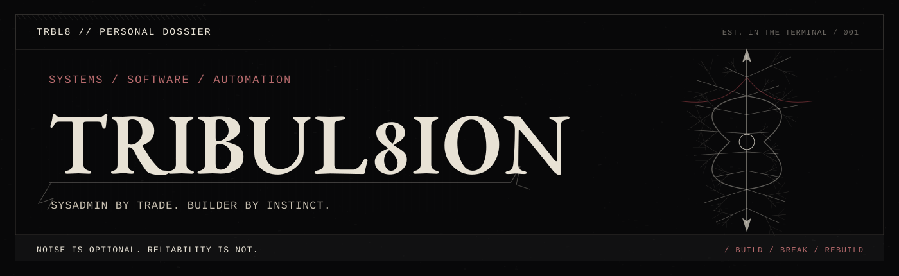

  

  <strong>I make repetitive work disappear.</strong> 
  Automation · Mobile applications · Infrastructure · Open source

  
  

01 — About
I'm Vlad — a systems administrator who enjoys building software and turning manual workflows into reliable, repeatable tools.

I work across Windows automation, Python utilities, Flutter applications, self-hosted infrastructure, and small hardware experiments. I care about reliability, thoughtful interfaces, reproducibility, and shipping software that actually helps.
02 — What I work on
Area	Focus
Automation & tooling	PowerShell, Python, Windows administration, process automation
Apps & interfaces	Flutter, Dart, local-first utilities, desktop UI
Infrastructure	Docker, Linux, self-hosting, observability
Embedded	ESP32, Arduino, lightweight status dashboards

03 — Toolkit

  
  
  
  
  
  
  
  
  
  

04 — Open-source
Frigate Telegram Enhanced — Russian localization
Merged contribution bringing Russian localization to the web interface and Telegram notifications of Frigate Telegram Enhanced.

Public repositories & experiments
Open-source contributions, custom setups, forks, and experiments.

  LESS CLICKING · FEWER SURPRISES · BETTER TOOLS

