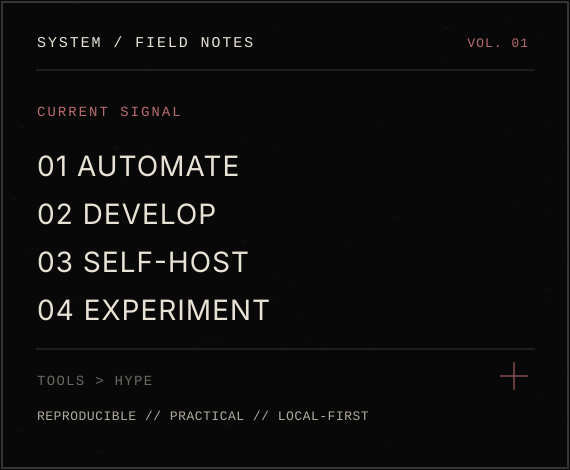
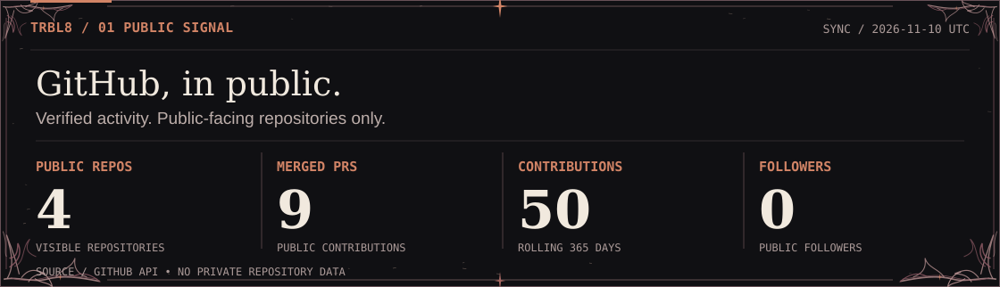
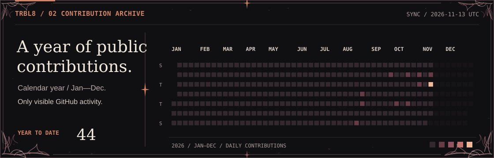
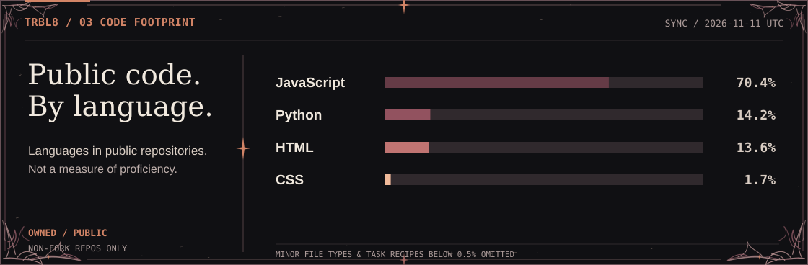
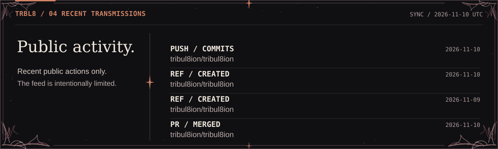

<!-- TRIBUL8ION // RAW BLACK METAL x AI DISPATCH EDITORIAL -->
<!-- All visuals are local. No image trackers / third-party render services. -->

  

SYSTEMS ADMINISTRATION &nbsp;/&nbsp; AUTOMATION &nbsp;/&nbsp; SOFTWARE ENGINEERING &nbsp;/&nbsp; OPEN SOURCE

<table><tr>
<td width="60%" valign="top">

<h3>01 / ABOUT THE OPERATOR</h3>

Hey. I'm <strong>Vlad</strong> — a systems administrator who builds useful software and automates the repetitive parts of IT.

Most days you'll find me somewhere between <strong>PowerShell, Python, Flutter, infrastructure and self-hosting</strong>. I care about predictable systems, maintainable code, and interfaces that don't waste your time.

<pre>&gt; build
&gt; break
&gt; verify
&gt; rebuild</pre>

<strong>Current directions:</strong> infrastructure automation · Flutter / Dart · tooling · ESP32 interfaces.

</td>
<td width="40%" align="center" valign="top">

</td>
</tr></table>

### 02 / LIVE TELEMETRY

Self-rendered SVG • public GitHub data • refreshed daily by GitHub Actions. Missing values remain undisclosed until the first successful sync.

<table><tr>
<td width="50%" valign="top"></td>
<td width="50%" valign="top"></td>
</tr></table>

### 03 / THE TOOLCHAIN

| SYSTEMS / AUTOMATION | APPS / DATA | INFRA / HARDWARE |
| :--- | :--- | :--- |
| `PowerShell` · `Python` · `Bash` | `Flutter` · `Dart` · `SQLite` | `Linux` · `Docker` · `Nginx` |
| `Windows` · `Git` | `TypeScript` · `HTML/CSS` | `ESP32` · `Arduino` · `Grafana` |

### 04 / SELECTED PUBLIC WORK

Only publicly verifiable work appears here; private projects and corporate infrastructure are not exposed.

### 05 / FREQUENCIES

[Public contributions](https://github.com/pulls?q=is%3Apr+author%3Atribul8ion) &nbsp;·&nbsp; [Repositories](https://github.com/tribul8ion?tab=repositories) &nbsp;·&nbsp; [Profile](https://github.com/tribul8ion)

<b>Behind the signal</b>

I build things across automation, mobile apps and home infrastructure. After hours: black metal, design experiments, and interfaces that look like industrial control systems.

The telemetry uses the [GitHub REST API](https://docs.github.com/en/rest) and [GraphQL API](https://docs.github.com/en/graphql) through a repository workflow. It reads only publicly visible data and renders local SVG images. No externally hosted stats service or personal access token is required.

