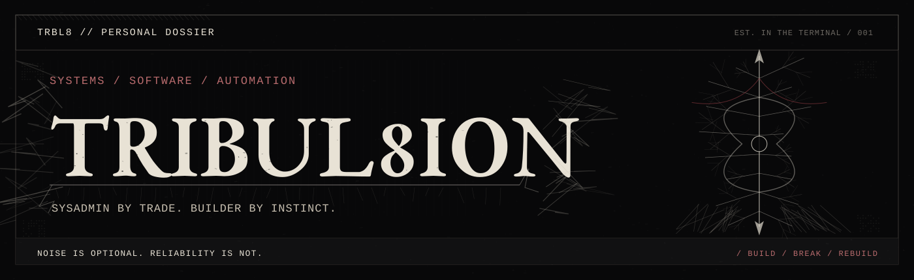
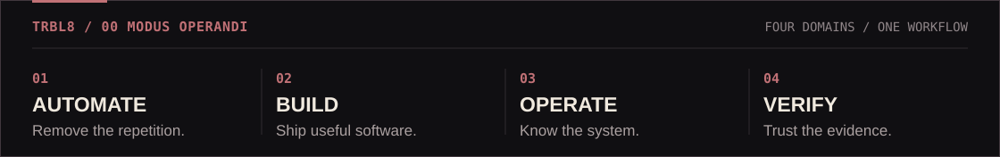
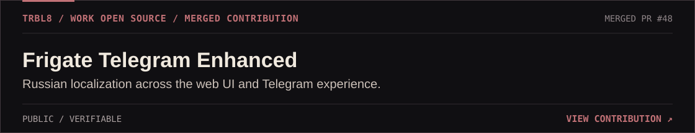
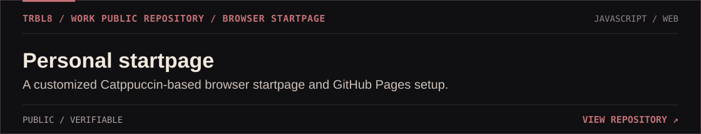
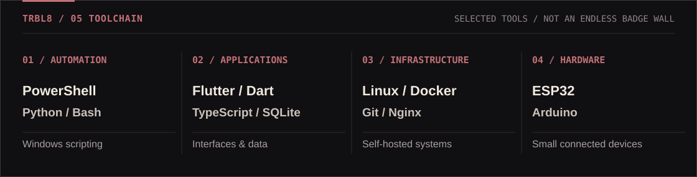
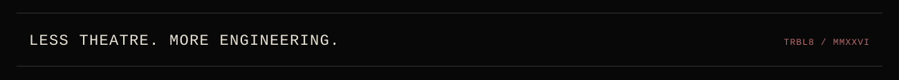

<!-- TRIBUL8ION / RAW BLACK METAL × EDITORIAL ENGINEERING -->
<!-- Static, repository-hosted SVG. No embedded scripts or third-party stats images. -->

  <picture><source media="(max-width: 800px)" srcset="./assets/mobile/hero.svg" /></picture>

### 01 / About the operator

I'm **Vlad** — a systems administrator who builds software and automates the repetitive parts of IT. I work at the intersection of **Windows automation, Python, Flutter, infrastructure and self-hosting**.

I prefer dependable tools, clear interfaces and tests that prove something actually works. Less busywork, more engineering.

  <picture><source media="(max-width: 800px)" srcset="./assets/mobile/operator-strip.svg" /></picture>

### 02 / Work in the open

Selected **public, verifiable** contributions and projects. Private repositories and internal systems stay private.

<a href="https://github.com/Limoniak/frigate-telegram-enhanced/pull/48"><picture><source media="(max-width: 800px)" srcset="./assets/mobile/project-frigate.svg" /></picture></a>

<a href="https://github.com/tribul8ion/tribul8ion.github.io"><picture><source media="(max-width: 800px)" srcset="./assets/mobile/project-startpage.svg" /></picture></a>

### 03 / Public telemetry

Self-rendered graphics using public GitHub data, refreshed by GitHub Actions. **A missing reading is shown as unavailable, never invented.**

<picture><source media="(max-width: 800px)" srcset="./assets/widgets/mobile/signal.svg?v=6a5b19c18c01" /></picture>

<picture><source media="(max-width: 800px)" srcset="./assets/widgets/mobile/heatmap.svg?v=02727063dab0" /></picture>

<picture><source media="(max-width: 800px)" srcset="./assets/widgets/mobile/languages.svg?v=9204a5f62061" /></picture>

<picture><source media="(max-width: 800px)" srcset="./assets/widgets/mobile/activity.svg?v=6a3b7b80dfa5" /></picture>

### 04 / The toolchain

<picture><source media="(max-width: 800px)" srcset="./assets/mobile/stack.svg" /></picture>

<strong>Tools &amp; telemetry details</strong>

**Automation:** PowerShell, Python, Bash, Windows. **Applications:** Flutter, Dart, TypeScript, SQLite. **Infrastructure:** Linux, Docker, Git, Nginx. **Hardware:** ESP32, Arduino.

The [widget source](./scripts/render_widgets.py) uses GitHub REST and GraphQL APIs. Its contribution count follows GitHub's public visibility rules; language percentages reflect GitHub-reported bytes, **not** skill or commit share. The public events feed covers a limited recent window. Visuals are generated as static SVG without tracking pixels or external render services. [Design specification](./DESIGN.md).

---

[**Pull requests**](https://github.com/pulls?q=is%3Apr+author%3Atribul8ion) · [**Repositories**](https://github.com/tribul8ion?tab=repositories) · [**GitHub profile**](https://github.com/tribul8ion)

<picture><source media="(max-width: 800px)" srcset="./assets/mobile/footer.svg" /></picture>

